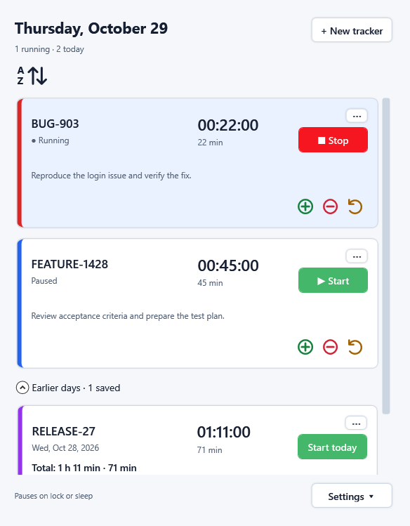
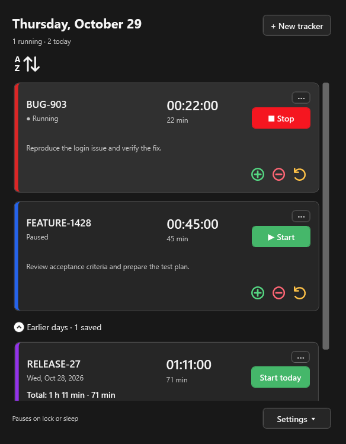

# Time Tracker

**Track the time you spend on development cards—one row per card, one button to start or stop.**

Time Tracker is a small Windows desktop app for people who switch between test planning, troubleshooting, testing, and finishing development cards. Keep a timer for each card reference, capture work throughout the day, and copy the totals into your usual timecard system when you are ready.

It works offline. There are no accounts, subscriptions, cloud services, or database servers to set up. The app does not connect to your employer's systems or send your data anywhere.

## Download and install

**[Download Time Tracker for Windows](https://github.com/R-Valdina/Ai-Time-Tracker/releases/latest)**

1. Open the download link above and find **Assets** on the release page.
2. Download **`TimeTracker-Setup-0.1.0-win-x64.exe`** for a Windows 11 PC with a 64-bit Intel or AMD processor.
3. Close an older copy of Time Tracker, if it is running, then double-click the installer.
4. Follow the setup wizard. It installs for your Windows user and creates desktop and Start menu shortcuts.
5. Open **Time Tracker** and select **+ New tracker** to add your first card reference.

**You do not need to clone this repository, install Git or Visual Studio, or install .NET separately.** The installer includes the runtime, README, installation guide, and app files. You only need internet access to download the release; installation and everyday use work offline.

The initial installer is unsigned, so Windows may show an unknown-publisher or reputation prompt. Follow your device's security policy; signing is not included in this release.

Prefer to run without installing? Download the release's **`TimeTracker-0.1.0-win-x64.zip`**, extract the entire folder, and open `TimeTracker.exe`. Keep the extracted files together.

The download also includes **README.txt**, **INSTALL.txt**, and **SHA256SUMS.txt**. The same written guides are installed beside the app. See the [full installation, update, and removal guide](docs/installation.md) for details.

## Screenshots

These are captures of the actual WPF application using disposable example data, in light and dark mode.

| Light mode | Dark mode |
| --- | --- |
|  |  |

## What you can do

- **Track each card separately.** Enter its reference number, choose an accent color, and optionally add a short description. Blue can represent features, red bugs, and other colors whatever fits your work.
- **Start and stop as you work.** The same button changes between green Start and red Stop. Time accumulates across sessions; multiple timers may run at once when needed.
- **See and copy your totals.** Rows show elapsed hours, minutes, and seconds, plus whole minutes. End an entry to finalize it and show both reporting formats directly on the row. Copy hours/minutes or total minutes from its menu. Partial minutes are not rounded up.
- **Find cards quickly.** In **Settings**, choose **Sort cards: ascending** or **descending**. Numbers sort naturally (`CARD-2` before `CARD-10`); **added order** restores the original sequence. Your choice is remembered. Earlier days keeps newer dates first and sorts references within each date.
- **Keep a useful history.** Archive ended trackers into **Earlier days** without losing their date, description, or total. Older rows are sorted newest first. Starting an older card creates or resumes today's unfinished entry; its previous total stays intact.
- **Pause automatically.** Active timers pause on Windows lock, sleep, session disconnection, or normal exit. Unlocking or waking does not restart them. At local midnight they pause and show a review warning for potentially forgotten time.
- **Make it comfortable.** Choose light, dark, or Follow Windows. Rows have colored borders and subtle shadows. The window grows with entries, supports resizing and maximizing, and remembers its size and placement.
- **Use the keyboard or Narrator.** Buttons have card-specific accessibility names. Tab and Shift+Tab reach descriptions with text; empty descriptions are skipped. Keyboard focus has a neutral visual indicator.

Trackers remain until you delete them and confirm. You can edit references, descriptions, and colors. This is a time-capture helper, not a replacement for your employer's timecard or billing system; time corrections are handled there.

## Quick workflow

1. Select **+ New tracker**, enter a reference and optional description, choose a color, and save.
2. Select **Start** when you begin work on that card; select **Stop** when you switch tasks or take a break.
3. Open the row's **…** menu to edit, copy a total, or **End entry**.
4. Copy your totals into your timecard system. Use **Archive to Earlier days** when you want an ended card out of the main area.
5. Use **Settings** to change themes or open the data folder.

## Your saved information

Choose **Settings → Open data folder**, or paste `%LOCALAPPDATA%\TimeTracker` into File Explorer.

| File | Contents |
| --- | --- |
| `tracker-data.json` | Card references, descriptions, dates, colors, totals, and ended/archive/review flags |
| `tracker-data.backup.json` | Previous successful tracker save |
| `preferences.json` | Theme, card sorting, and window size/placement |
| `preferences.backup.json` | Previous successful preference save |
| `time-tracker.lock` | Prevents concurrent writers; contains no tracker records |

Actions save immediately, and active work is checkpointed every five seconds. Normal exit pauses and saves timers. After an unexpected termination they reopen paused at the last successful checkpoint; recent unsaved time can be lost. A failed save is reported in the app. A corrupt primary can recover from its backup with a warning; unreadable primary and backup files are not silently reset.

Back up the data folder with the app closed. Files are readable JSON and are not encrypted. Installing an update or uninstalling the app leaves this separate data folder in place.

## For developers

The installed app needs no developer tools. This section is only for changing the source.

Time Tracker uses **C#/.NET 10 and WPF**. Timer rules and JSON persistence live in `TimeTracker.Core`; Windows integration and shared UI templates/styles live in `TimeTracker.Desktop`. Unit tests use xUnit; native Windows automation uses FlaUI. These dependencies are open source and do not require paid test services.

1. Install the .NET 10 SDK. Visual Studio Community with **.NET desktop development** is an optional free personal-use IDE under Microsoft's terms; the IDE itself is not open source.
2. Clone the repository and open `TimeTracker.slnx`.
3. Set `TimeTracker.Desktop` as the startup project and press F5.
4. Run the regression suites before making a release:

```powershell
./scripts/Test.ps1 -IncludeUi
```

Windows UI tests need an unlocked interactive desktop. They use isolated temporary data. Linux can run core tests and cross-build Windows projects, but cannot verify the running WPF app. Developer restore/build initially needs package downloads; the installed app does not.

- [Architecture and code walkthrough](docs/architecture.md)
- [Testing commands, coverage, and manual Windows checks](docs/testing.md)
- [Build a self-contained package and installer](docs/installation.md#build-a-release-from-source)
- [Dependency licenses](docs/third-party-notices.md)
- [Contribution and code standards](AGENTS.md)

GitHub Actions runs unit and Windows UI tests. The packaging workflow also captures screenshots, installs the setup executable, runs automation against the installed app, and verifies removal preserves user data. Tagging a tested version publishes the download assets. Local builds and tests do not require a paid service; hosted CI remains subject to GitHub's terms.

## License

[MIT](LICENSE). The self-contained distribution retains the applicable runtime and third-party notices.
