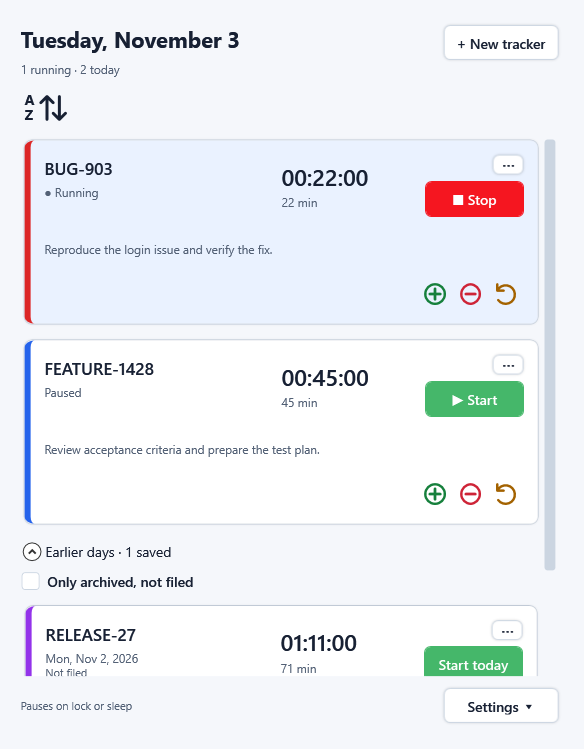
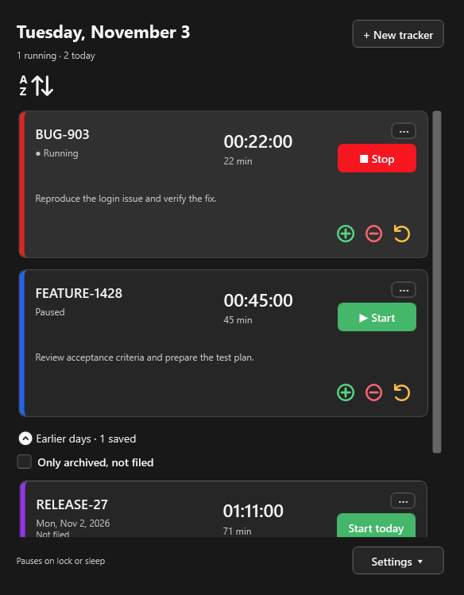

# Time Tracker

**Track work by card. Capture your time. Let an optional AI skill help with the reporting workflow.**

Time Tracker is a small, offline Windows desktop app for people who switch between test planning, troubleshooting, testing, and development cards. Give each card its own timer, capture work throughout the day, and use the totals in your usual timecard system.

Use it on its own, or connect a local AI skill that reads your tracked time and sends commands back to the app. Time Tracker runs locally without accounts, subscriptions, a database server, or an AI service. Your chosen external AI tool and timecard workflow are separate from the app.

## Download and install

**[Download Time Tracker for Windows](https://github.com/R-Valdina/Ai-Time-Tracker/releases/latest)**

1. Open the link above and expand **Assets** on the release page.
2. Download the **`TimeTracker-Setup-<version>-win-x64.exe`** installer for a Windows 11 PC with a 64-bit Intel or AMD processor.
3. Close Time Tracker if it is running, then open the installer.
4. Follow the setup wizard. It installs for your Windows user and creates desktop and Start menu shortcuts.
5. Open **Time Tracker** and select **+ New tracker**.

**No repository clone, Git, Visual Studio, or separate .NET installation is needed.** The installer includes the runtime, README, and installation guide. After downloading, installation and everyday tracking work offline.

To update, close the app and run the newer installer using the existing installation location. You do not need to uninstall first; your trackers and preferences stay in their separate data folder.

A portable **`TimeTracker-<version>-win-x64.zip`** is also available. Extract the entire folder and run `TimeTracker.exe`; keep its files together. Downloads include **README.txt**, **INSTALL.txt**, and **SHA256SUMS.txt**.

The installer is unsigned, so Windows may show an unknown-publisher or reputation prompt. Follow your device's security policy. See the [full installation, update, and removal guide](docs/installation.md).

**AI integration needs the version 2 data/inbox support described below. Releases v0.1.2 and earlier provide manual tracking and do not include this integration.**

## Screenshots

These are captures of the actual WPF application using disposable example data.

| Light mode | Dark mode |
| --- | --- |
|  |  |

## What you can do

- **Track each card separately.** Enter any card reference or label, choose an accent color, and optionally add a short description. There is no required card-number format.
- **Start and stop as you work.** One button switches between green Start and red Stop. Time accumulates across sessions; multiple timers can run when needed.
- **See and copy totals.** Rows show hours, minutes, and seconds, plus whole minutes. End an entry to display its final reporting total. Copy hours/minutes or total minutes from its menu. Partial minutes are not rounded up.
- **Adjust or reset time.** The green **+** and red **−** icons accept `1:30` or `90` for 90 minutes. Enter or OK saves; Escape or Cancel discards. Subtraction stops at zero. The amber reset icon clears the total and pauses the tracker.
- **Sort by card reference.** The stacked letters-and-arrows control switches between A–Z and Z–A. Numbers sort naturally (`CARD-2` before `CARD-10`), and the app remembers your choice.
- **End and archive together.** Use **End and archive** from a row's **…** menu. Separate **End entry** and **Archive to Earlier days** actions remain available. Filing is optional; archiving an unfiled entry needs no warning or external posting.
- **Keep a useful history.** Earlier days retains entries until you delete them. **Unarchive** prepares a paused, zero-time entry for today while keeping the historical record. An existing unfinished entry for today is reused without resetting or pausing it. **Start today** also starts the restored card.
- **See what has been filed.** Entries with an external TimecardId show a small check mark. Its tooltip includes the ID and posting time. Archived entries without an ID show neutral **Not filed** text. Expand Earlier days and select **Only archived, not filed** to find entries awaiting filing.
- **Pause automatically.** Timers pause on Windows lock, sleep, session disconnection, and normal exit. They stay paused after unlocking or waking. Local midnight pauses active timers and flags potentially forgotten time for review.
- **Choose your appearance.** Light, dark, and Follow Windows themes, colored row borders, resizing, maximizing, and remembered window placement.
- **Use the keyboard or Narrator.** Actions have descriptive accessibility names. Tab navigation reaches populated descriptions and uses a neutral focus indicator.

## A normal workday

1. Create a tracker with a reference, optional description, and color.
2. Select **Start** when working on that card and **Stop** when switching tasks or taking a break.
3. Adjust time if needed, then copy the total into your reporting workflow.
4. Choose **End and archive** when finished, or use the separate actions.
5. Review Earlier days or restore a card for another day.

You can use this entire workflow without AI or any connection to an employer's systems.

## Use Time Tracker with an AI skill

A local Claude skill or another AI tool with local file access can use Time Tracker's **file-based integration**. The app supplies the data and command protocol; you configure the skill in your chosen tool using the [integration guide](docs/skill-integration.md). A ready-made AI skill or timecard-system connection is not bundled with the app.

For example, a skill can:

1. Read tracked entries and prepare a summary of your work and totals.
2. Help you review the entries for your timecard system.
3. Submit an `end` command when a tracker should stop.
4. After your external workflow successfully posts a timecard entry, submit `complete` with its returned ID and posting timestamp.
5. Let the app mark that tracker as filed and move it into history.

Connecting to and posting in an external timecard system is handled by your chosen skill/workflow. Time Tracker itself only reads local commands and updates its own local data.

### Read data; send commands through the inbox

The default folder is:

```text
%LOCALAPPDATA%\TimeTracker
```

Skills may read **`tracker-data.json`**. Each entry has a stable `Id`, a free-text `Label`, its date and elapsed time, description and state flags, plus nullable `TimecardId` and `PostedAt` posting fields.

**Time Tracker must remain the only writer of its data.** Skills must never edit `tracker-data.json`, its backup, preferences, or the lock file. To request a change, write a new command into **`inbox\`**.

Write each command to a unique `.tmp` file in the inbox, close it, then rename it to `.json`. Replace the sample RowId below with the actual entry's `Id`.

**Stop and end an entry:**

```json
{
  "Command": "end",
  "RowId": "4ef4da84-a52e-41c8-bd33-0bb7a8bf13e8"
}
```

**Record a successful posting, end the entry, and archive it in one save:**

```json
{
  "Command": "complete",
  "RowId": "4ef4da84-a52e-41c8-bd33-0bb7a8bf13e8",
  "TimecardId": "TC-2026-0042",
  "PostedAt": "2026-11-03T12:30:00-05:00"
}
```

### What happens after a command

- The app processes commands in order on its UI thread. Entries update live without opening a popup or taking keyboard focus.
- Commands already in the inbox are processed when the app starts. Commands sent while it is closed wait there.
- A successful command is saved immediately, then its file is deleted. If saving fails, the file stays queued for retry.
- Repeating `end` is safe. Repeating `complete` with the same TimecardId preserves the original posting details. A different ID is rejected and never overwrites an existing posting.
- Malformed commands, unknown entries, unknown commands, and conflicting IDs go to **`inbox\rejected\`**, with a short `.json.txt` reason beside each file and a line in **`time-tracker.log`**. Rejections do not show a popup.

Saves use a flushed temporary file and replacement so readers receive complete JSON snapshots. Windows readers should retry brief file-open/sharing failures; they must not interpret those failures as empty data.

See the [full integration guide](docs/skill-integration.md) for command validation, safe PowerShell publishing, ordering, retries, and acknowledgment behavior.

## Your saved information

Choose **Settings → Open data folder**, or open `%LOCALAPPDATA%\TimeTracker` in File Explorer.

| File or folder | Contents |
| --- | --- |
| `tracker-data.json` | Entries, totals, state flags, and optional TimecardId/PostedAt posting fields |
| `tracker-data.backup.json` | Previous successful tracker snapshot |
| `preferences.json` | Theme, sorting, and window size/placement |
| `preferences.backup.json` | Previous successful preference snapshot |
| `time-tracker.lock` | Prevents concurrent app writers; contains no tracker records |
| `inbox\` | Commands waiting for the app |
| `inbox\rejected\` | Rejected commands and reason files |
| `time-tracker.log` | Local inbox rejection and I/O messages |

### Existing data upgrades automatically

Version 1 data loads with the same entry IDs, labels, colors, dates, totals, descriptions, and flags. The app writes **version 2**, adding `TimecardId: null` and `PostedAt: null` to existing entries. The previous primary is retained as the backup during migration; later saves rotate that backup as usual.

**Back up your data folder with the app closed before upgrading. Older app versions that only support version 1 cannot read version 2 data.**

Actions save immediately, and active work is checkpointed every five seconds. Normal exit pauses and saves timers. After an unexpected termination they reopen paused at the last successful checkpoint; recent unsaved time can be lost. A corrupt primary can recover from its backup with a warning; unreadable primary and backup files are not silently reset.

Files are readable JSON and are not encrypted. Installing an update or uninstalling the app leaves this separate data folder in place.

## For developers

The installed app needs no developer tools. This section is for changing the source or building an integration.

Time Tracker uses **C#/.NET 10 and WPF**. Timer rules, command behavior, and JSON persistence live in `TimeTracker.Core`; Windows integration, the inbox watcher, and shared UI styles/templates live in `TimeTracker.Desktop`. Unit tests use xUnit; native Windows automation uses FlaUI. No new runtime dependencies are required for skill integration.

1. Install the .NET 10 SDK. Visual Studio Community with **.NET desktop development** is an optional free personal-use IDE under Microsoft's terms; the IDE itself is not open source.
2. Clone the repository and open `TimeTracker.slnx`.
3. Set `TimeTracker.Desktop` as the startup project and press F5.
4. Run the regression suites:

```powershell
./scripts/Test.ps1 -IncludeUi
```

Windows UI tests need an unlocked interactive desktop and use isolated temporary data. Linux can run core tests and cross-build Windows projects, but cannot verify the running WPF app. Initial restore/build needs package downloads; the installed app does not.

Every behavior change needs relevant tests. Integration coverage includes migration, command validation, duplicate and conflicting postings, atomic saves and reader retries, FIFO processing, incomplete files, persistence failures, live filing status, filtering, and focus preservation.

- [AI skill integration and command reference](docs/skill-integration.md)
- [Architecture and code walkthrough](docs/architecture.md)
- [Testing commands, coverage, and manual Windows checks](docs/testing.md)
- [Build a self-contained package and installer](docs/installation.md#build-a-release-from-source)
- [Dependency licenses](docs/third-party-notices.md)
- [Contribution and code standards](AGENTS.md)

GitHub Actions runs core and Windows UI tests. Packaging also captures screenshots, installs the setup executable, tests the installed app, and verifies that removal preserves user data. Tagging a tested version publishes the downloads. Local builds and tests require no paid test service; hosted CI remains subject to GitHub's terms.

## License

[MIT](LICENSE). The self-contained distribution retains applicable runtime and third-party notices.
