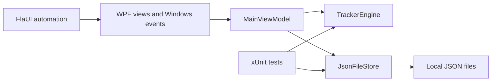

# How the code fits together

## Solution structure

| Project | Responsibility |
| --- | --- |
| `src/TimeTracker.Core` | Timer rules, immutable data records, duration formatting, atomic JSON storage |
| `src/TimeTracker.Desktop` | WPF views, binding models, dialogs, themes, Windows events |
| `tests/TimeTracker.Core.Tests` | Deterministic unit tests and real-file persistence tests |
| `tests/TimeTracker.Ui.Tests` | FlaUI tests against the real Windows executable |

## Follow one Start click

1. The shared row template in `MainWindow.xaml` invokes `ToggleTracker`.
2. `MainViewModel.Toggle` asks `TrackerEngine` to start or stop that entry.
3. `TrackerEngine` samples its injected clock and updates immutable entry records. It never touches WPF or disk.
4. `MainViewModel` saves the snapshot and refreshes row bindings.
5. The WPF dispatcher refreshes displays each second and checkpoints totals every five seconds.

`TrackerRowViewModel` formats one entry for the same template used in Today and Earlier days. Reusable button/menu styles and light/dark palette resources live in `Themes`; no separate duplicated pages implement those appearances.

## Time and lifecycle decisions

The engine receives `TimeProvider` and `TimeZoneInfo`. Tests advance a manual clock rather than sleeping. UTC instants measure elapsed time; local calendar dates determine daily boundaries. Each running entry has an in-memory last-sampled timestamp. Repeated refreshes and starts do not add the same interval twice. Backwards clock changes never subtract recorded time; forward manual clock changes can affect elapsed time, so use the review process before reporting totals if the system clock was changed.

Running state is never serialized. After a process kill, power loss, or restart, only recorded totals survive and every timer is paused. Windows session, suspend, and exit notifications call the same `PauseAll` path. Startup holds a file lock scoped to the data directory to prevent simultaneous writers.

Midnight truncates active entries at the previous day's boundary and sets `NeedsReview`. A late tick cannot accrue overnight time. Starting an older entry preserves it and creates or resumes today's unfinished entry with the same reference.

## Storage safety

`JsonFileStore<T>` is reused for tracker data and preferences. It validates loaded documents, writes a complete temporary file, flushes it, and atomically replaces the primary while keeping a previous backup. Recovery never replaces a good backup with the damaged primary. If neither saved copy is readable, startup stops with an explanation. Save errors appear in the app; closing with unsaved changes requires an explicit decision.

JSON is versioned so future migrations can be explicit. Do not change the file schema without migration/recovery tests. No storage service or dependency injection framework is needed for this scope.

## Read and extend the code

Start with `TrackerEntry`, `TrackerEngine`, and their tests; then read `MainViewModel` and the shared row template. XML `/// 
` comments explain types and methods in IDE hover tooltips. Keep event handlers focused on presentation or OS integration. New timing behavior belongs in the engine with deterministic tests, not copied into view handlers.

Windows-specific UI and lifecycle behavior need Windows verification. See [testing.md](testing.md). The diagram below describes dependencies, not background services:

